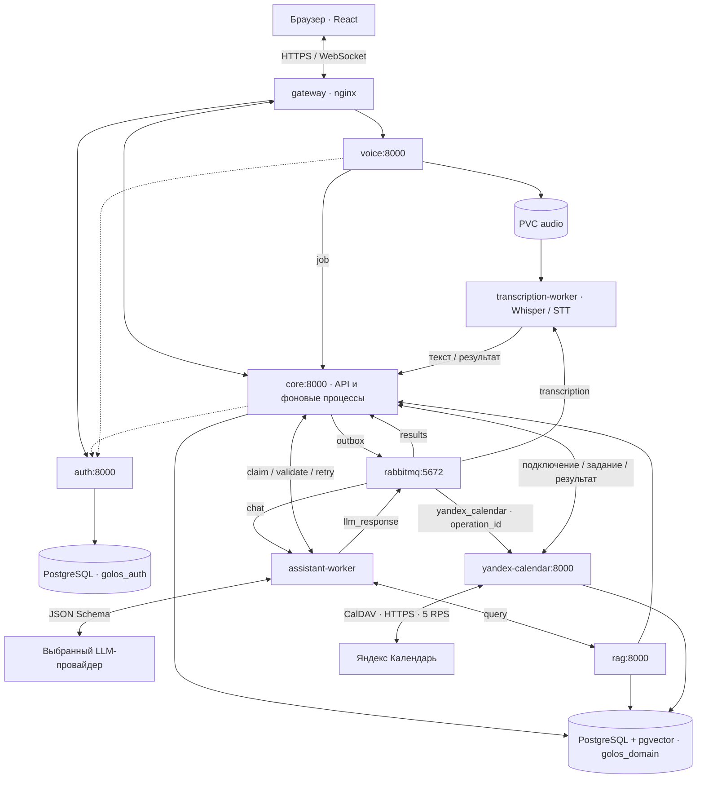

# Архитектура Голос v2

[Запуск и эксплуатация](README.md) · [Команды и ветки модели](docs/llm-service.md)

## Компоненты

Приложение работает в namespace `voice-assistant`. Каждый сервис имеет Deployment; HTTP-компоненты доступны через Service/DNS. Сервисы самостоятельны: код, зависимости (`pyproject.toml`, `uv.lock`) и Dockerfile лежат в `services/<имя>/app/`, общего каталога нет. Небольшие общие части (`common/`, доставка RabbitMQ, описания таблиц для миграции в auth) — копии в тех сервисах, которым они нужны.

| Deployment | Точка запуска | Ответственность |
|---|---|---|
| gateway | nginx | Статика React, HTTPS, HTTP/WebSocket proxy |
| auth | `backend.auth.main:app` | Пользователи, пароли, сессии и timezone |
| core | `backend.chat.application` | Записи, чат, jobs, события и применение решений |
| voice | `backend.voice.main:app` | Авторизация загрузки аудио и регистрация job |
| rag | `backend.rag.main:app` | Типизированные запросы и гибридный поиск |
| assistant-worker | `backend.workers.assistant` | Контекст, LLM, исправления и публикация решения |
| transcription-worker | `backend.workers.transcription` | Распознавание и передача текста в core |
| yandex-calendar | `backend.yandex_calendar.main:app` | Подключения пользователей, CalDAV и доставка результатов синхронизации |
| db / rabbitmq / ollama | Соответствующие образы | Хранение, доставка, локальный inference |

Core запускает пять дочерних процессов: API, publisher, results, reminders и index. Это один контейнер. Остановка дочернего процесса завершает группу; Kubernetes перезапускает контейнер. SIGTERM передаётся всем процессам, после 20 секунд оставшиеся завершаются принудительно.

## Данные и границы доверия

Auth и domain используют разные базы/пользователей PostgreSQL на общем сервере. Auth хранит хеш сессионного токена; браузер отправляет cookie `golos_session`. Core и Voice проверяют сессию через Auth. Внутренний HTTP защищён `X-Internal-Token`; gateway закрывает `/internal`. Внешние порты приложения публикует gateway.

Модель не обращается к БД и не выполняет SQL. Владелец бизнес-правил — core domain: права на запись, версия, параметры, generation диалога и claim token. Подтверждение мутаций core формирует из сохранённых значений. `ready` с одним текстом допустим для обычного ответа и ничего не изменяет.

## Жизненный цикл задания

1. Core транзакционно сохраняет сообщение, job и outbox до HTTP 202. Publisher передаёт идентификатор job в RabbitMQ.
2. Worker получает через claim историю, pending-контекст, timezone и время запроса. Используются последние 30 релевантных сообщений.
3. Модель возвращает `clarify`, `query` или `ready`. Worker проверяет схему и ссылки, выполняет query через RAG.
4. Для конечного решения вызывается `/internal/jobs/{job_id}/validate`. Core использует тот же код применения, что и сохранение, внутри обязательно откатываемого savepoint. Записи, версии, outbox и события не сохраняются. Ошибки возвращаются модели; общий предел — восемь обращений.
5. Worker публикует проверенное решение в `llm_response`. Процесс results передаёт его core, который повторно проверяет данные и применяет весь пакет атомарно. Предварительная проверка не резервирует состояние: последующий конфликт версии остаётся возможным.
6. Ответ и события сохраняются в БД и поступают в браузер. Повтор терминального результата не применяет команды снова. Ошибка финального применения сохраняется как понятное сообщение об ошибке.

Lease задания — 12 минут; очистка чата увеличивает generation и отменяет применение старого ответа. Есть retry/dead очереди и лимит пяти попыток доставки. Долгие модельные вызовы и порядок обновления сервисов должны укладываться в эти ограничения; подробности ACK и восстановления смотрите в `services/core/app/backend/chat/broker.py` (воркеры используют его копию `backend/broker.py`).

Голос отправляется одним файлом. После STT backend создаёт текстовое сообщение и assistant-job; frontend не отправляет распознанный текст повторно. Очистка истории отменяет применение старой транскрипции. HTTP восстанавливает состояние после переподключения WebSocket.

## Синхронизация с Яндекс Календарём

Источник правды — локальные встречи. Пользователь подключает свой аккаунт паролем приложения и выбирает доступный для записи календарь. Новые встречи отправляются автоматически; кнопка «Синхронизировать встречи» в настройках ставит на сверку все текущие встречи, включая созданные до подключения. Внешние изменения связанных событий перезаписываются, отсутствующие события восстанавливаются. Посторонние события Яндекса не затрагиваются. Серия и исключения хранятся одним iCalendar-ресурсом с устойчивым UID.

Core сохраняет неизменяемый снимок встречи и outbox в транзакции локального изменения. Publisher отправляет только `operation_id` в durable-очередь `yandex_calendar`; для повторов и исчерпания попыток используются retry/dead-очереди. Сервис получает задание через защищённый внутренний API core, последовательно обрабатывает ревизии встречи и сохраняет результат до callback. ACK выполняется после подтверждения core. Core сохраняет статус и событие `yandex_calendar_sync` транзакционно; frontend получает обновления через WebSocket и восстанавливает их через REST. Локальное сохранение не зависит от доступности Яндекса.

Сервис хранит подключения, зашифрованные credentials, соответствия UID/адресов ресурсов, ETag и журнал операций в отдельных таблицах существующей domain-БД. Ключ Fernet `YANDEX_TOKEN_KEY` приходит из Secret `secrets`; пароль не передаётся в RabbitMQ, браузер после сохранения или LLM. Внутренние endpoints защищены `INTERNAL_TOKEN`. Отключение удаляет credentials и прекращает выполнение старых заданий, сохраняя внешние события; новое подключение получает новое поколение.

CalDAV работает только с доверенным HTTPS-сервером `caldav.yandex.ru`, без редиректов. Обновление и удаление используют свежий ETag и `If-Match`; неоднозначный результат записи требует сверки перед повтором. Яндекс не гарантирует `If-None-Match`, поэтому восстановление после потерянного ответа создания ограничено безопасным чтением и поиском UID. Общий лимит обоих HTTP-транспортов — 5 RPS на процесс без накопления burst-квоты; текущий Deployment использует одну реплику. Временные ошибки повторяются с учётом `Retry-After`, отзыв пароля требует переподключения. Подробности и ограничения — в [инструкции интеграции](docs/yandex-calendar.md).

## Хранение, конфигурация и ошибки

PVC обеспечивают PostgreSQL, RabbitMQ, аудио и кеши моделей. Audio разделяют Voice и transcription-worker; search-кеш — core и RAG. ReadWriteOnce требует согласованного размещения на узлах и не является готовой отказоустойчивой схемой.

Адреса и путь конфигурации приходят из ConfigMap `config`, ключи — из Secret `secrets`. Файл профилей встроен в образ assistant-worker; ConfigMap `providers` сейчас не смонтирован. Выбор профиля хранится в Setting в domain-БД, регистрируется worker и кешируется им до 30 секунд. Подробнее — README.

Ошибки схемы и бизнес-правил возвращаются модели как структурированные данные с путями полей. Ошибки сети обрабатываются механизмом доставки. Пользователь получает русские сообщения без traceback, ключей и сырых JSON. Интерфейс различает ошибки форм, фоновых операций и заданий, не дублируя уже сохранённые сообщения чата.
