# Голосовой ассистент «Голосок»

> Прототип личного ассистента: понимает запросы на естественном языке — текстом или голосом — и помогает с задачами, встречами и напоминаниями. Ищет старые записи по смыслу, следит за конфликтами в расписании и синхронизируется с реальным Яндекс Календарём.

---

## TL;DR — как сразу начать пользоваться

1. Откройте [`https://194.169.160.248:31016`](https://194.169.160.248:31016).
2. Войдите в готовый аккаунт `hackaton:hackaton` (или зарегистрируйтесь).
3. (По желанию) в настройках подключите Яндекс Календарь и включите «Озвучивать ответы».
4. Готово — просто напишите или скажите ассистенту, например:
   - «Завтра у меня будет встреча в 15:00 с Аней на час»
   - «Какой план на завтра?»
   - «Найди задачу про презентацию»
   - «Создай напоминание»

Локальное развёртывание всей инфраструктуры — см. [`Локальное развёртывание`](docs/local-setup.md).

### Киллер-фичи

- 🎙️ **Голос в обе стороны** — распознаёт речь (локальный Whisper) и озвучивает ответы (TTS, *Text-to-Speech* в браузере).
- 🤖 **LLM предлагает, а не пишет в БД** — модель возвращает структурированное решение, все изменения проверяет и атомарно применяет "движок" системы. SQL запросы LLM-кой не генерим)
- 📅 **Живой календарь** — встречи синхронизируются с Яндекс Календарём.
- 🔎 **Семантический поиск** — ассистент понимает смысл, а не только слова («В каких ресторанах я побывал?»).
- ⚠️ **Защита расписания** — предупреждает о пересечении встреч и просит подтверждения.

---

## Основные сценарии

Ассистент работает с тремя типами сущностей. Ниже действия и примеры запросов, которые их покрывают:

| Действие | Встреча | Напоминание | Задача | Пример запроса |
|---|:---:|:---:|:---:|---|
| Создать | ✅ | ✅ | ✅ | «Завтра у меня будет встреча в 15:00 с Аней на час» |
| Завершить | ❌ | ✅ | ✅ | «Отчёт я сделал, выкинь эту задачу» |
| Удалить | ✅ | ✅ | ✅ | «Я хочу забыть про оплату интернета» |
| Перенести | ✅ | ✅ | ❌ | «Аня не обидется, если я перенесу встречу завтра на вечер» |
| Редактировать | ✅ | ✅ | ✅ | «У задачи про отчёт так-то есть имя — "Итоги квартала"» |
| Получить информацию о предстоящих событиях | ✅ | ✅ | ✅ | «Я сегодня что-то кому-то должен?», «Какой план на завтра?», «Что у меня на этой неделе?» |
| Найти старые задачи и события | ✅ | ✅ | ✅ | «Найди задачу про презентацию», «Когда у меня была встреча с Иваном?» |
| Повторить | ✅ | ✅ | ❌ | «Встречаться с командой мне предстоит каждый понедельник, напоминай мне об этом...» |

### Дополнительные сценарии

| Возможность | Реализовано | Что делает система | Комментарий / Пример запроса |
|---|:---:|---|---|
| Голосовой ввод | ✅ | Распознаёт речь (Whisper / внешний STT) и дальше обрабатывает как текст | Нажмите кнопку микрофона |
| Голосовой вывод | ✅ | Озвучивает ответы помощника через Web Speech API | Включите «Озвучивать ответы» в настройках |
| Обработка конфликтующих встреч | ✅ | Предупреждает о пересечении и предлагает перенести; требует подтверждения | «**Ассистент:** Встреча в 15:00 уже существует, перенести на то же время на завтра?» |
| Повторяющиеся задачи и встречи | ✅ | Учитывает исключения и различает правку серии и одного повторения | «Перенеси только следующую встречу с Аней на 16:00» |
| Семантический поиск по старым записям | ✅ | Находит по смыслу через RAG + pgvector, а не только по словам | «Когда у меня была встреча с Севой?» |
| Синхронизация с Яндекс Календарём | ✅ | Синхронизирует встречи с реальным Яндекс Календарём по CalDAV | «Синхронизировать встречи» в настройках |
| Поддержка нескольких пользователей | ✅ | Отдельные аккаунты, сессии, часовые пояса и изоляция данных | Регистрация в интерфейсе |
| Уточняющий диалог | ✅ | Сохраняет контекст и задаёт вопрос, если данных не хватает | «Создай напоминание» → «Когда?» |
| Вычисление свободного времени | ✅ | Ищет свободные интервалы в рабочем окне | «Найди свободный час завтра с 9 до 18» |

### А что мы сделали ещё?

| Возможность | Что делает система | Пример |
|---|---|---|
| Уведомить о наступлении | Вовремя напоминает о задаче/встрече голосом и через браузерные уведомления, даже когда вкладка закрыта | Настройки → Уведомления браузера |
| Выбор LLM-провайдера | Переключается модель в настройках без передеплоя: внешняя или локальная | Настройки → Провайдер ИИ |
| Мобильная адаптация | Полноценный адаптивный интерфейс с сохранением десктопного вида | Все экраны доступны на телефоне |
| **Тёмная и светлая тема😏** | Переключается в один клик | Настройки → Внешний вид |
| Локальный LLM (Ollama) | Работает полностью офлайн с Qwen3 14B | Провайдер «Ollama · local» |
| Мониторинг и логирование | Grafana + Loki + Grafana Alloy для логов с корреляционными ID | см. подробности в главе *Наша кухня* |
| WebSocket-события в реальном времени | Карточки результатов и статусы приходят мгновенно | Автоматически при ответе ассистента |
| Автовосстановление после разрыва WebSocket | Состояние восстанавливается через HTTP | Переподключение сети |
| Идемпотентная отправка | Повторная доставка не применяет команды дважды | Дубликат ответа брокера |
| Демо-режим интерфейса | Работа без backend с мок-данными | см. подробности в главе *Как использовать → Локально* |
| Оптимистичная блокировка версий | Конкурентные правки не теряются, конфликты возвращаются модели | Два пользователя меняют одну запись |

---

## Как использовать

### Продакшн версия

\* На красивый домен денег не хватило, оставили "мужской" вариант)

1. Зайдите на [`https://194.169.160.248:31016`](https://194.169.160.248:31016)
2. Зарегистрируйтесь или используйте готовый аккаунт `hackaton:hackaton` (где мы уже помучили агента) \
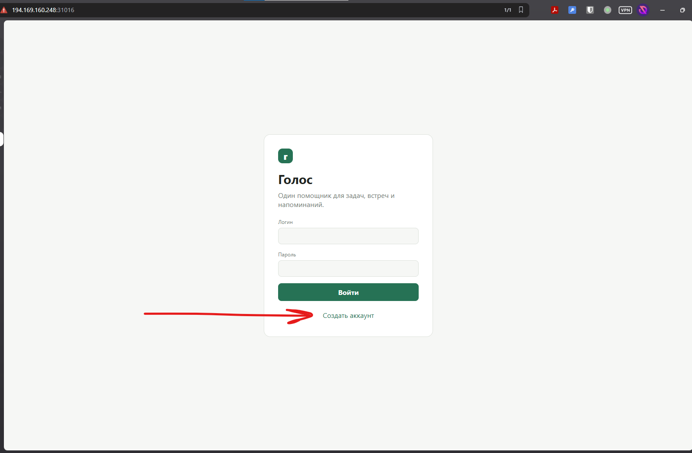

3. (По желанию) подключите Яндекс Календарь в настройках для полного экспириенса \
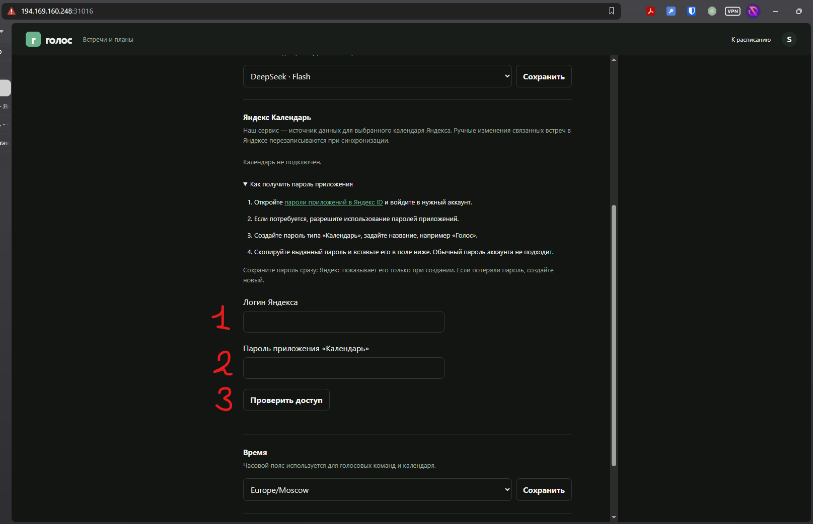 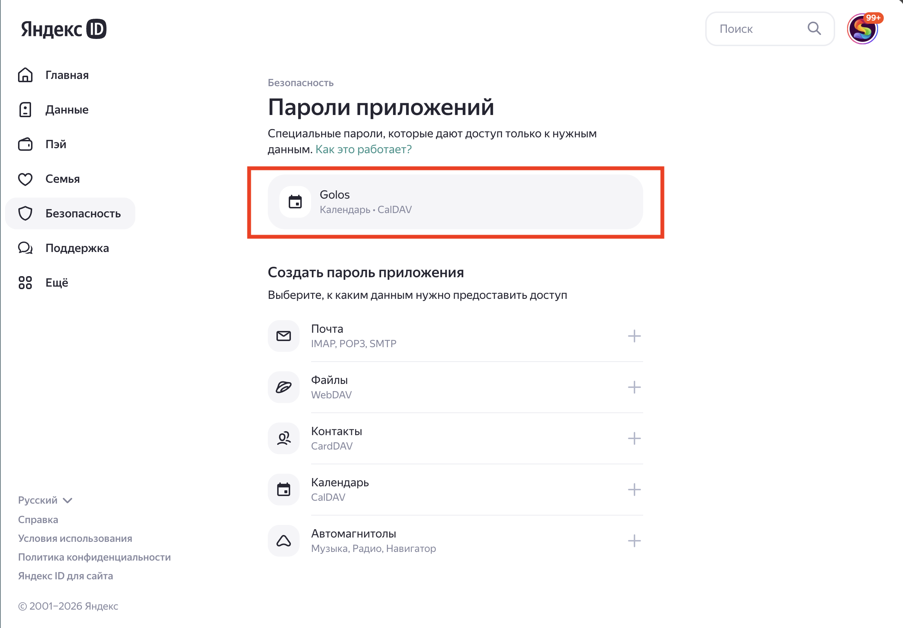

4. **Вы готовы к работе!**

#### Примеры запросов описаны в сценариях выше, вот несколько из них

- Создание встречи с синхронизацией с Яндекс Календарём \
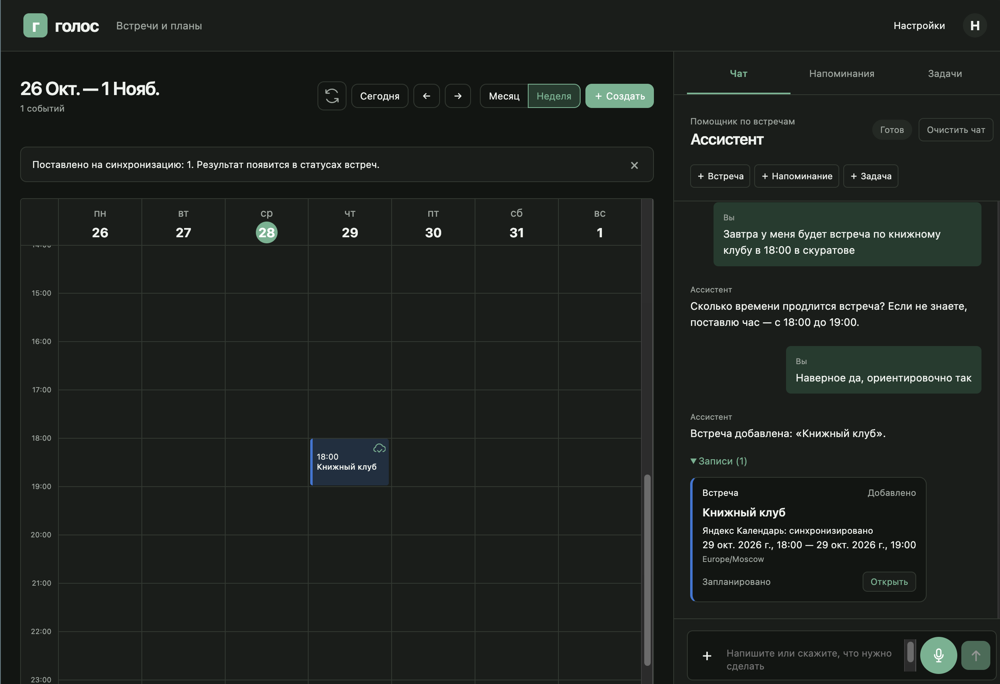 

- Поиск встреч \
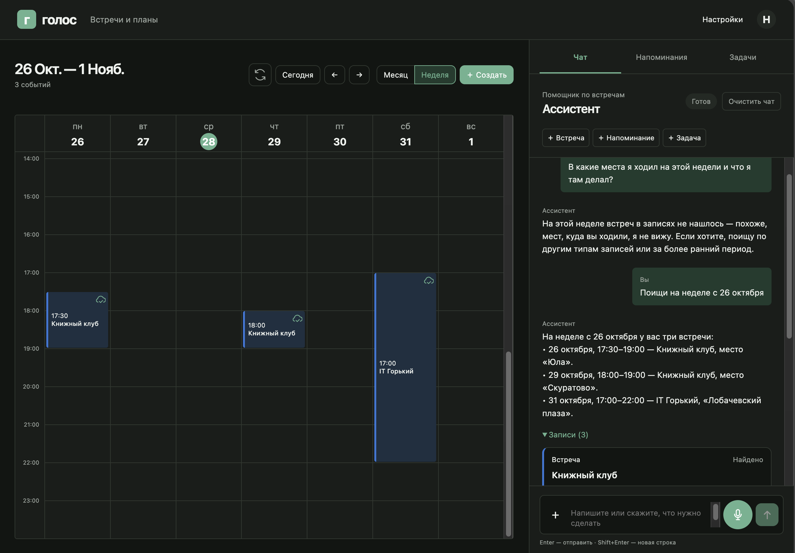


### Локальная версия

> [`Локальное развёртывание`](docs/local-setup.md)

Полная пошаговая инструкция, как поднять всю инфраструктуру локально и запустить проект целиком *(почти как у нас на проде)*.

---

## Краткое описание архитектуры

«Голосок» построен на микросервисной архитектуре.

**Ключевой принцип:** LLM не обращается к БД и не выполняет SQL. Модель возвращает структурированное решение, а "движок" [core-модуль](services/core/app/backend/chat/application.py) проверяет бизнес-правила, права пользователя и версии записей, после чего атомарно применяет изменения в PostgreSQL.

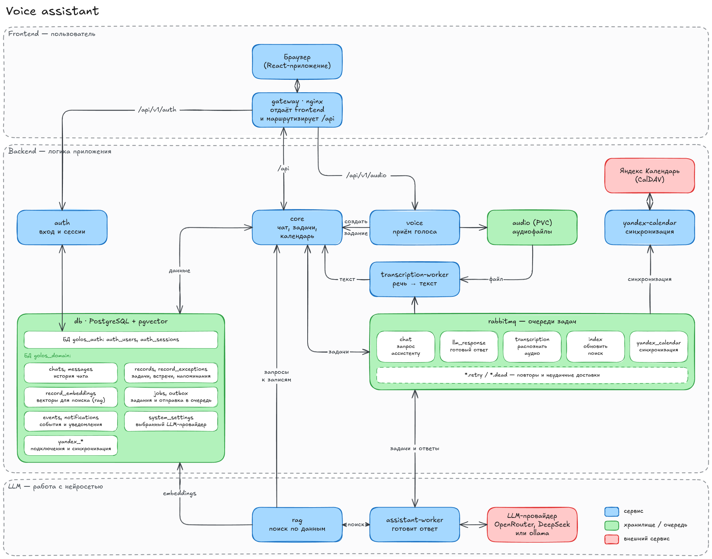

### Жизненный цикл запроса

1. Пользователь отправляет текст или голос → voice распознаёт аудио в текст.
2. Core сохраняет сообщение, задание и outbox одной транзакцией и отвечает HTTP 202.
3. Через RabbitMQ задание получает assistant-worker → собирает контекст (последние 30 сообщений, часовой пояс) и вызывает LLM.
4. Модель возвращает `clarify` (уточнить), `query` (получить данные через RAG) или `ready` (ответ/действие).
5. Core **предварительно проверяет** решение без сохранения, затем применяет его одной транзакцией и формирует подтверждение.
6. Результат и карточки записей отправляются в браузер по WebSocket.

#### Схемы маршрута запроса, блоков сервисов и трёх веток модели

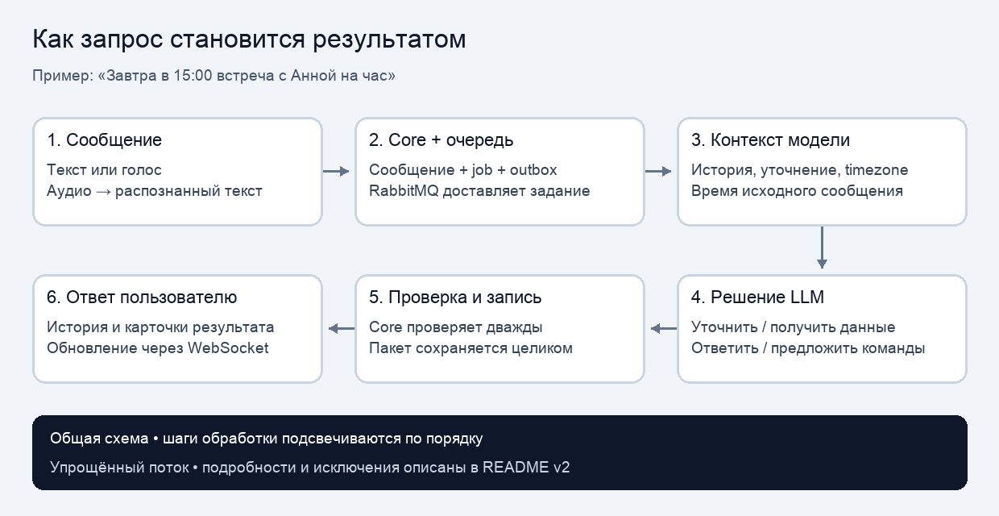 \
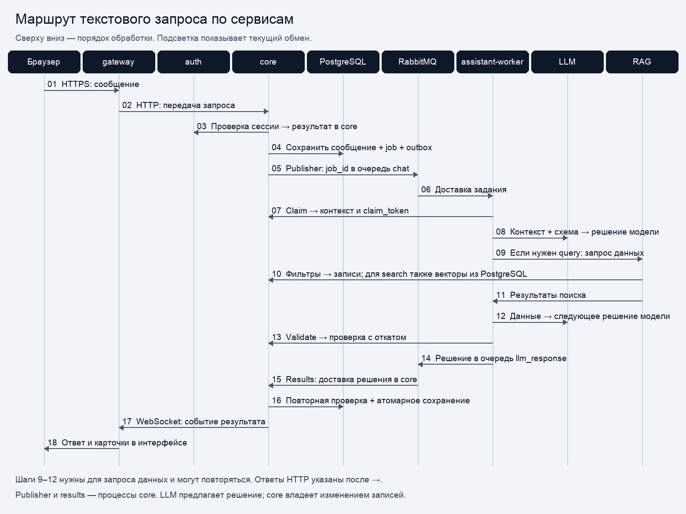 \
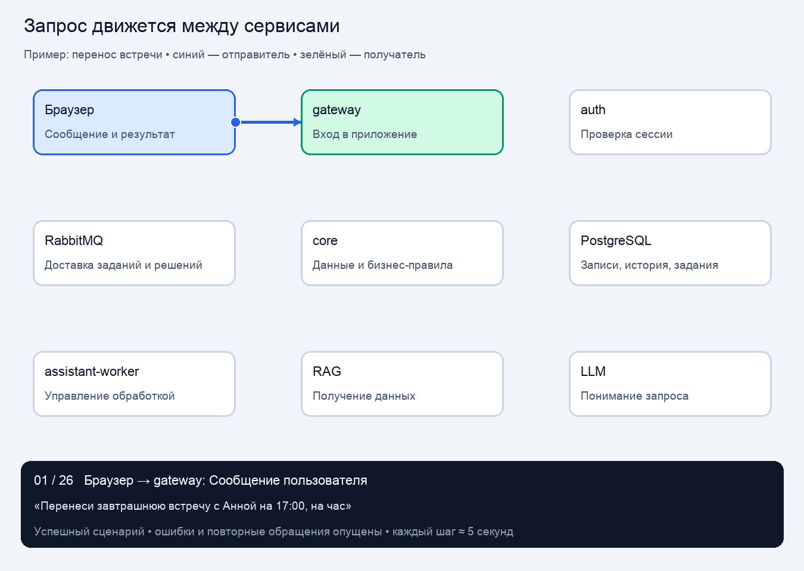 \
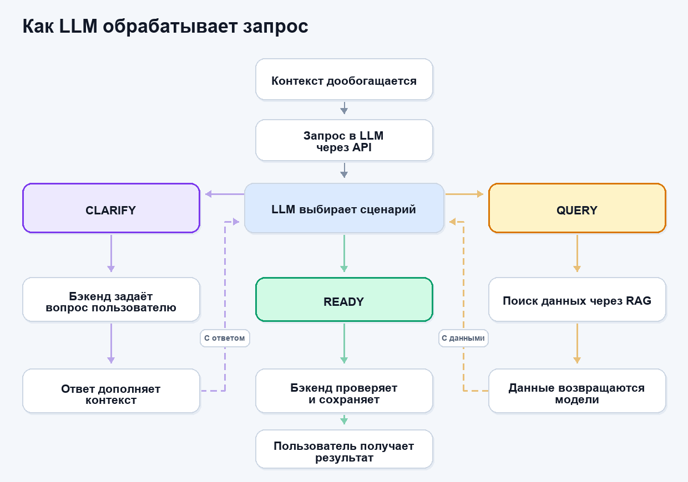 \

> Детальное описание компонентов, очередей, моделей данных и обработки ошибок — в документе [`Архитектура`](docs/architecture.md), а точный контракт LLM — в [`LLM: схема решений`](docs/llm-service.md).

#### Как устроен семантический поиск по старым записям

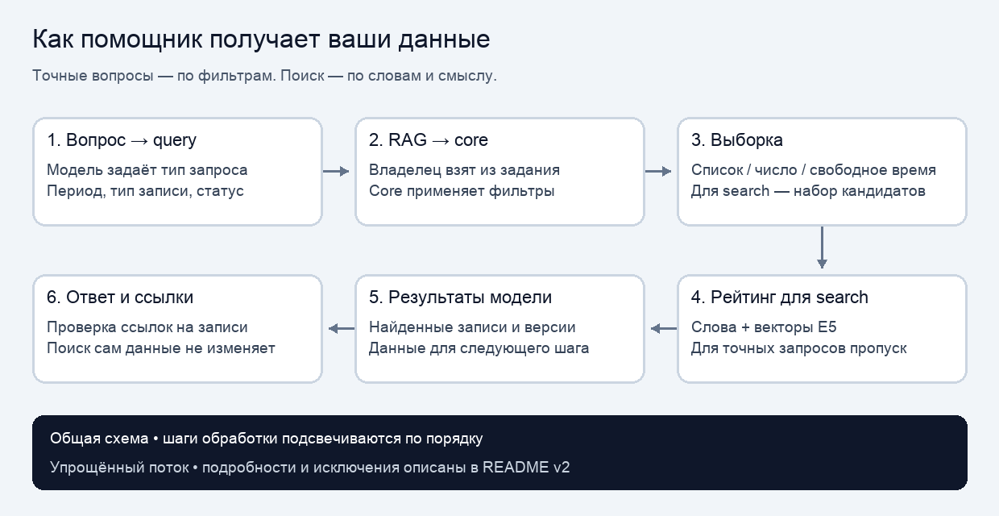

> Подробно про точный и смысловой поиск (RAG + pgvector) — в [`Архитектура → Поиск`](docs/architecture.md#поиск-точный-и-семантический).

### Наши технологии

| Технология | Почему выбрали |
|---|---|
| **Python 3.12 + FastAPI** | Быстрая разработка backend-сервисов, асинхронность, явные Pydantic-схемы |
| **PostgreSQL + pgvector** | Отношения/транзакции и векторный поиск по смыслу в одной БД |
| **RabbitMQ** | Лёгкий по сравнению с другими брокерами; надёжная доставка заданий между сервисами, retry/dead-очереди, outbox |
| **React 19 + Vite** | Удобный интерактивный интерфейс, WebSocket-обновления в реальном времени |
| **nginx (gateway)** | Единая точка входа, HTTPS, прокси HTTP и WebSocket |
| **LLM (OpenRouter / DeepSeek / Ollama)** | Де-факто стандарт для подобных задач; гибкость: от сильноточных внешних моделей до полностью локальной работы офлайн |
| **Whisper + Web Speech API** | Распознавание и синтез речи, интересующее решение по голосовому интерфейсу |
| **Docker + Kubernetes (k3s)** | Изоляция микросервисов, простое развёртывание и масштабирование |
| **Argo CD** | GitOps-синхронизация состояния кластера с репозиторием, удобный UI |
| **Woodpecker CI** | Лёгкий и универсальный CI: собирает только изменённые сервисы и раскатывает их — выбрали, т.к. просто хотели его проверить)<br>**P.S:** вау-эффекта не произвёл( |
| **Grafana / Loki / Alloy** | Стандарт в опенсорсе для сбора и просмотра логов; корреляционные ID запросов |

---

## Наша кухня

CI/CD построен на **Woodpecker CI** и **Argo CD** (GitOps). Никаких тяжёлых настроек: код пушится в ветку, пайплайн сам собирает только изменённые сервисы и разворачивает их в k3s-кластере.

Ход работы (`infra/ci/run_cd.py`):

1. Достаём список изменённых файлов из коммита командой `git diff --name-only HEAD^1`.
2. Определяем, какие каталоги сервисов затронуты и находим в них `build.sh`.
3. Запускаем `build.sh` для **каждого изменённого каталога** — образ собирается по Podman, пушится во внутренний registry и вызывает `rollout restart` соответствующего Deployment. Изменение одного сервиса пересобирает только его.
4. Чистим устаревшие образы (`podman image prune`), чтобы не копить кеш.
5. Отдельный шаг пайплайна синхронизирует приложение в Argo CD (`argocd app sync voice-assistant`).

```yaml
steps:
  - name: build          # собирает изменённые сервисы
    commands: [python3 infra/ci/run_cd.py .]
  - name: argocd-sync    # применяет новые образы в k3s
    commands: [argocd app sync voice-assistant --server argocd-server...]
```

Тесты тоже встроены в процесс: у каждого сервиса свои `pytest`, отдельно запускаются межсервисные контрактные тесты (`tests/integration`) и полный e2e-набор сценариев (`tests/e2e`). Production-сборка frontend проверяется `npm run build`.

---

## Сами решали и что бы улучшили

### Что мы решили сами

| Решение | Как и почему |
|---|---|
| **Типы записей: задача / встреча / напоминание** | Встреча — жестко привязана к диапазону времени и синхронизируется с календарём; задача и напоминание — более свободные записи с датой/статусом. |
| **«LLM предлагает, а не пишет в БД»** | Модель возвращает `Decision`, а проверку прав, бизнес-правил и версий берёт на себя core. Это защита и от галлюцинаций, и от самовольных изменений. |
| **Микросервисы вместо монолита** | Не только из-за стабильности, но и потому, что голос (Whisper) и LLM требуют разных ресурсов и их можно масштабировать независимо. |
| **PostgreSQL + pgvector для всего** | Отношения, транзакции и векторный поиск по смыслу в одной СУБД — не тянем отдельный поисковый движок. |
| **RabbitMQ + outbox-паттерн** | Задание пишется в БД одной транзакцией с сообщением, а брокер доставляет его с retries/dead-очередями. Гарантирует доставку и идемпотентность. |
| **Ветки модели `clarify` / `query` / `ready`** | Модель сама решает: уточнить, поискать в базе или ответить/выполнить. Так поиск и уточняющий диалог встроены в один вызов LLM. |
| **Локальный Whisper + Web Speech API TTS** | STT полностью свой и работает офлайн; синтез речи делаем в браузере — не держим отдельный TTS-сервис. |
| **Переключаемые LLM-провайдеры** | OpenRouter / DeepSeek / локальная Ollama (Qwen3 14B) — от быстрой внешней модели до полностью офлайн-режима без интернета. |

### Что бы мы улучшили

- **Агентный режим и более сложные цепочки действий** — чтобы «перенеси все встречи с Аней на неделю вперёд» обрабатывалось как серия согласованных шагов, а не одиночный запрос.
- **Полноценный синтез речи на backend** — сейчас озвучка идёт через Web Speech API в браузере; серверный TTS дал бы одинаковый голос на любых устройствах и в push-уведомлениях.
- **Избирательная память (long-term memory)** — хранить сжатую историю предпочтений и фактов о пользователе, чтобы ассистент не терял контекст между сеансами.
- **Ветку несогласованного отката (compensation)** — если цепочка действий частично не выполнилась, автоматически откатывать уже применённые шаги.
- **Нагрузочные и fault-инъекционные тесты** — проверить поведение при падении RabbitMQ, LLM и Whisper под нагрузкой.
