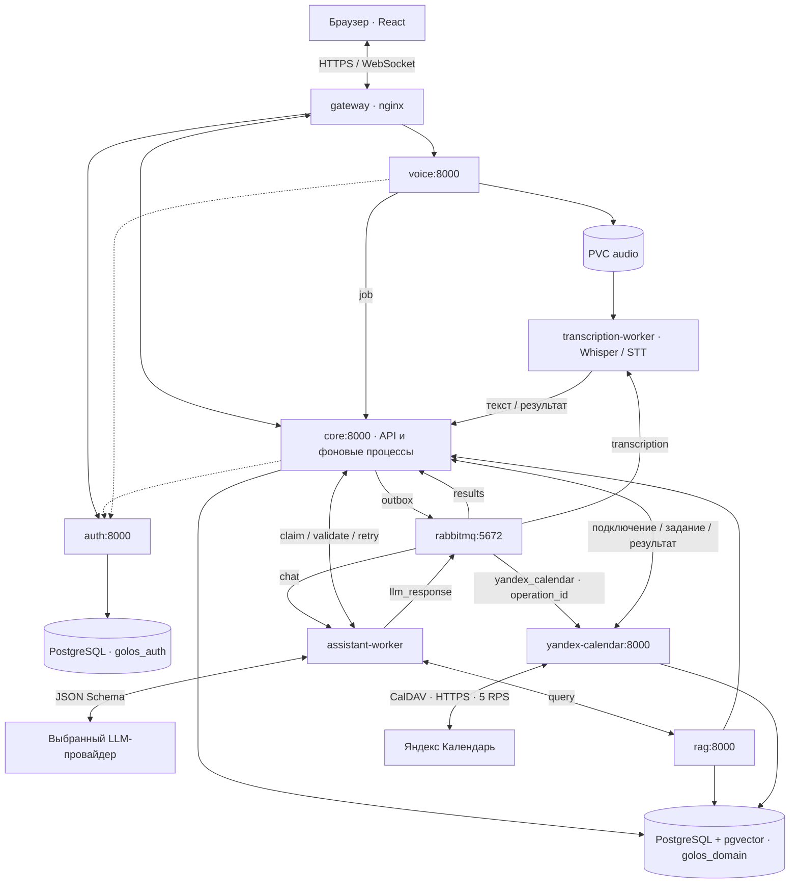

# Детальная архитектура «Голосок»

Этот документ описывает устройство системы: сервисы, очереди, модели данных и жизненный цикл обработки запроса. Краткое описание — в основном [README](../README.md).

## Структура репозитория

```
.
├── apps/                      # Argo CD: приложения (одно на сервис) + app-of-apps
├── infra/
│   ├── ci/                    # Woodpecker CI: run_cd.py + образ пайплайна
│   ├── registry/              # внутренний Docker-реестр
│   ├── tailscale/             # доступ к кластеру извне
│   ├── voice-assistant-access/# RBAC
│   └── woodpecker/            # сервер и агенты CI
├── services/
│   ├── base/                  # общие secret.yaml, configmap.yaml, pvc.yaml
│   ├── auth/                  # пользователи, пароли, сессии, timezone
│   ├── core/                  # записи, чат, задания, применение решений ("движок" системы)
│   ├── voice/                 # авторизация загрузки аудио, регистрация задания
│   ├── rag/                   # типизированные запросы и гибридный поиск
│   ├── gateway/               # nginx + React-статика (frontend)
│   ├── assistant-worker/      # контекст, LLM, публикация решения
│   ├── transcription-worker/  # Whisper / STT → текст в core
│   ├── yandex-calendar/       # подключение календаря, CalDAV, доставка
│   ├── db/                    # PostgreSQL + pgvector
│   ├── rabbitmq/              # очередь заданий
│   ├── ollama/                # локальный LLM
│   └── logging/               # Grafana · Loki · Alloy
└── secrets.sh                 # скрипт-заготовка для секретов
```

Каждый сервис в `services/<имя>/` состоит из двух частей:
- `app/` — код (Python/React), `pyproject.toml`/`package.json` и `uv.lock`/`package-lock.json`, свой Dockerfile и `build.sh`. Поверх `app/` лежит `deployment.yaml` (и при необходимости `service.yaml`) — Kubernetes-манифест сервиса.
- Внутри Python-сервиса: `backend/<модуль>/*.py` — код, `backend/common/` — переиспользуемые копии, `tests/` — pytest-набор каждого сервиса.

> Примечание: для генерации этого дерева локально выполните `tree -a -I 'node_modules|__pycache__|.git'` в корне репозитория.

## Компоненты и ответственность

Приложение работает в namespace `voice-assistant`: сервисы, очереди и БД развёрнуты в одном кластере k3s. Воркеры (assistant, transcription, yandex-calendar) несут копию доставки RabbitMQ `backend/broker.py` и общих частей `backend/common/` из core — эти копии обновляются во всех сервисах одновременно при изменении контракта.



| Deployment | Точка запуска | Ответственность |
|---|---|---|
| gateway | nginx | Статика React, HTTPS, HTTP/WebSocket proxy |
| auth | `backend.auth.main:app` | Пользователи, пароли, сессии и timezone |
| core | `backend.chat.application` | Записи, чат, задания, события и применение решений |
| voice | `backend.voice.main:app` | Авторизация загрузки аудио и регистрация задания |
| rag | `backend.rag.main:app` | Типизированные запросы и гибридный поиск |
| assistant-worker | `backend.workers.assistant` | Контекст, LLM, исправления и публикация решения |
| transcription-worker | `backend.workers.transcription` | Распознавание речи и передача текста в core |
| yandex-calendar | `backend.yandex_calendar.main:app` | Подключения пользователей, CalDAV, доставка синхронизации |
| db / rabbitmq / ollama | Соответствующие образы | Хранение, доставка, локальный inference |

Core запускает пять дочерних процессов в одном контейнере: API, publisher, results, reminders и index. Остановка дочернего процесса завершает всю группу, Kubernetes перезапускает контейнер. SIGTERM передаётся всем процессам; после 20 секунд оставшиеся завершаются принудительно.

## Жизненный цикл запроса

Ключевой принцип: **модель предлагает решение, но не меняет данные напрямую.** Модель возвращает структурированный `Decision`, а core проверяет бизнес-правила, права пользователя, версии записей и только затем атомарно сохраняет изменения в PostgreSQL.

1. **Ввод.** Пользователь отправляет текст или аудио. Голос сначала распознаётся в текст и идёт по тому же пути; браузер не отправляет транскрипцию повторно.
2. **Регистрация.** Core сохраняет сообщение, задание (`job`) и запись в очередь (`outbox`) одной транзакцией. HTTP 202 означает принятие в обработку.
3. **Контекст.** Через RabbitMQ задание получает assistant-worker, который запрашивает у core последние 30 релевантных сообщений, незавершённое уточнение, часовой пояс и время запроса.
4. **Решение.** Модель возвращает `clarify`, `query` или `ready` по JSON Schema. При поиске результаты возвращаются модели для следующего шага.
5. **Проверка и запись.** Core предварительно проверяет решение в savepoint без сохранения. После доставки результата он проверяет его повторно и применяет команды одной транзакцией: пакет либо сохраняется целиком, либо откатывается.
6. **Ответ.** В историю попадают итог и карточки записей; интерфейс получает обновления по WebSocket, после переподключения состояние восстанавливается через HTTP.

### Три ветки решения модели

| Ветка | Когда нужна | Результат |
|---|---|---|
| `clarify` — уточнить | Не хватает параметров | Вопрос пользователю и сохранённый контекст для продолжения |
| `query` — получить данные | Нужны записи, количество или свободное время | Запрос через RAG/core, затем новое обращение к модели |
| `ready` — завершить | Можно ответить или выполнить действие | Обычный ответ либо проверенный пакет команд |

Модель может исправлять ошибки: невалидный JSON, ошибки схемы и бизнес-правил возвращаются ей с конкретными путями полей. На один цикл отводится до восьми обращений к LLM; lease задания ограничивает общее время (12 минут).

## Данные и границы доверия

- Auth и domain используют разные БД/пользователей PostgreSQL на общем сервере.
- Браузер отправляет cookie `golos_session`; core и voice проверяют сессию через auth.
- Внутренний HTTP защищён `X-Internal-Token`; gateway закрывает `/internal`.
- Модель не обращается к БД и не выполняет SQL. Владелец прав и бизнес-правил — core.
- Для обновления/удаления нужны точные `id` и `version`, полученные запросом данных; чужая запись недоступна даже при знании идентификатора.
- Версия записи позволяет обнаружить изменение между поиском и сохранением (оптимистичная блокировка).
- Удаление основной записи логическое: запись помечается удалённой и исключается из обычной работы.
- Cookie сессии `golos_session` хранится как HttpOnly; `COOKIE_SECURE` в Auth включён по умолчанию.

## Что передаётся моделям

Выбранный LLM-провайдер получает контекст диалога, время и часовой пояс, результаты запрошенных выборок и ошибки проверки для исправления. **В этих данных могут быть тексты личных задач, встреч и заметок.** Вся база не передаётся целиком в каждом запросе, но приложение нельзя считать полностью локальным при выборе внешнего провайдера.

Распознавание речи настраивается отдельно: локальный Whisper обрабатывает аудио в инфраструктуре приложения; внешний STT-провайдер получает аудиофайл. Модель E5 строит поисковые векторы в сервисе приложения.

### Модели данных

| Данные | Содержимое и назначение |
|---|---|
| Задача (`task`) | Название, заметки, статус, необязательный срок |
| Встреча (`meeting`) | Название, начало и окончание, часовой пояс; окончание строго позже начала |
| Напоминание (`reminder`) | Название и обязательное время напоминания |
| Повторения | Ежедневное, еженедельное или ежемесячное правило; исключения для отдельных повторений |
| Диалог | Сообщения, карточки результатов и контекст незавершённого уточнения |
| Обработка | Задания, результаты, события, уведомления и очередь отправки |
| Поисковый индекс | Векторное представление записи, версия и имя embedding-модели |

У основной записи есть владелец `user_id`, идентификатор `id` и версия `version`. Для повторяющихся записей `scope=series` меняет всю серию, а `scope=occurrence` — одно повторение по его точному времени.

## Поиск: точный и семантический

**Точные вопросы** — «что завтра», «сколько задач», «ближайшая встреча» — обрабатываются типизированными запросами через core. Применяются владелец, тип записи, статус и период, учитываются повторения.

**Поиск по тексту и смыслу** использует RAG:

1. Core формирует допустимый набор записей пользователя с фильтрами.
2. Текстовый поиск оценивает совпадения слов в названии и заметках; семантический сравнивает векторы запроса и записей, созданных моделью E5, через pgvector.
3. RAG объединяет два рейтинга и возвращает ограниченный список.
4. Модель получает найденные записи и формирует ответ; ссылки в ответе проверяются по реальным результатам.

Индекс обновляется в фоне и может отставать от записи; источник истины — записи PostgreSQL, а не поисковые векторы.

## Доставка сообщений RabbitMQ

- Все очереди используют единый consumer (core и его копии в воркерах).
- ACK следует после успешной обработки или подтверждённой публикации в retry/dead-очередь; после пяти неудачных попыток доставки задание попадает в dead-очередь и завершается понятной ошибкой.
- Транзакционный outbox: записи outbox помечаются опубликованными после подтверждения брокером; сбой до коммита может вызвать повторную публикацию.
- HTTP 409 не сжигает попытку; сетевая ошибка вызывает повтор с backoff в 5 секунд.
- Общий асинхронный дедлайн обработчика — 600 секунд, lease задания — 720 секунд.
- Очистка чата увеличивает `generation` диалога и отменяет применение уже устаревшего ответа; голос и транскрипция идут тем же путём, при очистке отменяется и применение старой транскрипции.

## Синхронизация с Яндекс Календарём

- Источник правды — локальные встречи. Пользователь подключает аккаунт паролем приложения и выбирает календарь.
- Новые встречи отправляются автоматически; кнопка «Синхронизировать встречи» ставит на сверку все текущие встречи.
- Внешние изменения связанных событий перезаписываются, отсутствующие восстанавливаются; посторонние события Яндекса не затрагиваются.
- Core сохраняет неизменяемый снимок встречи и outbox в транзакции, publisher отправляет только `operation_id` в durable-очередь.
- Credentials хранятся зашифрованными ключом Fernet (`YANDEX_TOKEN_KEY`), не передаются в RabbitMQ, браузер или LLM.
- CalDAV работает только с доверенным `https://caldav.yandex.ru`; все исходящие запросы ограничены 5 RPS на процесс.
- Изменение и удаление используют свежий ETag и `If-Match`; локальное сохранение не зависит от доступности Яндекса.

## Обработка пересечений встреч

Core предварительно применяет весь набор команд в savepoint, проверяет итоговое расписание и откатывает эффекты. При пересечении `/validate` возвращает 422 с кодом `meeting_conflict`. После вопроса согласие пользователя подтверждается случайным одноразовым токеном, который core сверяет вместе со всем набором команд. Создание и изменение учитывают весь набор: пересечение может быть разрешено удалением или переносом другой встречи в том же наборе. Бессрочные серии требуют ограничения (`count`/`until`) для гарантии отсутствия пересечений.

## Хранение, конфигурация и наблюдаемость

- PVC — PostgreSQL, RabbitMQ, аудио и кеши моделей. ReadWriteOnce требует согласованного размещения подов на узлах.
- Адреса и конфигурация приходят из ConfigMap `config`, ключи — из Secret `secrets`.
- Профили LLM встроены в образ worker (`providers.yaml`); ConfigMap `providers` сейчас не смонтирован, поэтому его изменение само по себе не меняет настройки worker. Выбор провайдера хранится в БД, кешируется до 30 секунд и доступен в настройках интерфейса.
- Логи собираются стеком Grafana · Loki · Grafana Alloy в отдельном namespace мониторинга.
- Ошибки схемы и бизнес-правил возвращаются модели как структурированные данные с путями полей; пользователь получает русские сообщения без traceback, ключей и сырых JSON.

## Документы

- Контракт LLM и его схема решений: [`docs/llm-service.md`](llm-service.md)
- Три ветки решения модели (`clarify` / `query` / `ready`): [`docs/llm/`](llm/README.md)
- Доставка RabbitMQ: [`docs/rabbitmq-delivery.md`](rabbitmq-delivery.md)
- Интеграция с Яндекс Календарём: [`docs/yandex-calendar.md`](yandex-calendar.md)
