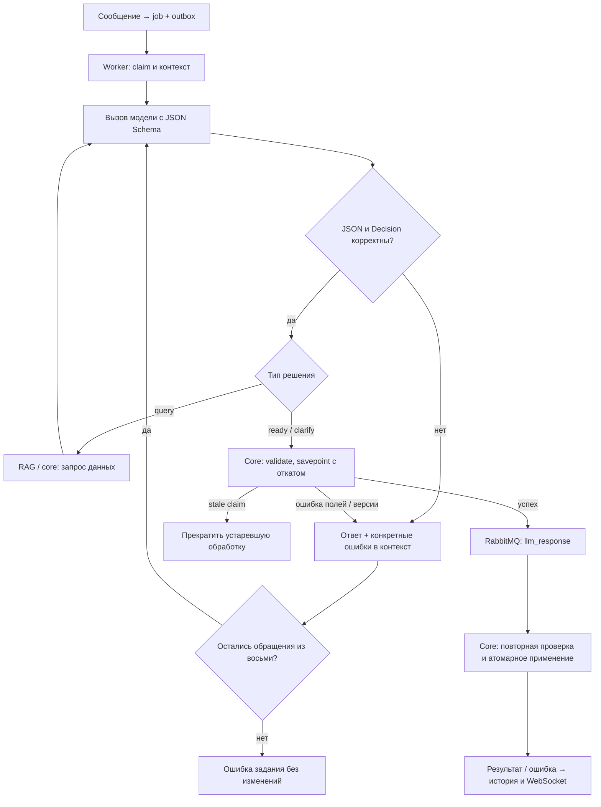

# LLM: схема решений, команды и ветки обработки

[README](../README.md) · [Архитектура](../ARCHITECTURE.md)

Источники контракта: `shared/backend/common/schemas.py`, `shared/backend/chat/domain.py`, `services/assistant-worker/app/backend/llm/` и `services/core/app/backend/chat/`. Worker — обработчик очереди `chat`, отдельного публичного API у него нет.

## Контекст и передача схемы

Worker получает от core через claim: `job_id`, `claim_token`, `user_id`, `timezone`, `generation`, `requested_at`, последние релевантные сообщения и незавершённое уточнение `pending`. Системный промпт содержит UTC/local время сообщения и timezone. Относительные даты модель определяет относительно этого времени, а не момента завершения генерации.

История передаётся в `messages`. После query добавляются решение assistant и результат данных. После невалидного ответа — предыдущий ответ assistant и сообщение с конкретными ошибками. Результаты поиска, история и ошибки — данные, не новые системные инструкции.

`TypeAdapter(Decision).json_schema()` генерирует схему, включая Command, Fields, Query, RecordReference и Recurrence. `strict_schema()` удаляет defaults, устанавливает `additionalProperties: false` и делает объявленные поля обязательными для ответа провайдера. Nullable-поля заполняются `null`, списки без элементов — `[]`.

Схема передаётся отдельным полем HTTP-запроса к `/chat/completions`:

```python
response_format = {
    "type": "json_schema",
    "json_schema": {
        "name": "decision",
        "strict": True,
        "schema": strict_schema(TypeAdapter(Decision).json_schema()),
    },
}
```

Не каждый провайдер одинаково поддерживает structured outputs. HTTP 200 не означает валидный JSON или сохранение данных. Pydantic повторно проверяет ответ; бизнес-проверки вроде сравнения дат выполняются в приложении. Провайдерская JSON Schema не кодирует все Python-валидаторы.

## Decision

| Поле | Назначение |
|---|---|
| `type` | `clarify`, `query` или `ready` |
| `answer` | Обычный ответ; подтверждение изменения заменяется результатом core |
| `commands` | До пяти команд `create/update/delete` |
| `question` | Вопрос пользователю для `clarify` |
| `context` | Намерение и известные параметры для продолжения уточнения |
| `query` | Один типизированный запрос данных |
| `record_refs` | До 100 ссылок `{id, version, occurrence_at}` на реально полученные записи |

### Ветки

- **clarify:** непустой вопрос, контекст намерения, `commands=[]`, `query=null`, `record_refs=[]`. Core сохраняет pending; пользователь отвечает обычным сообщением.
- **query:** запрос данных, без команд и record_refs. После результата worker снова обращается к модели; эта ветка не публикуется как конечный ответ.
- **ready с командами:** предварительная проверка core, публикация, повторная проверка и атомарное сохранение. Core формирует подтверждение из применённых записей.
- **ready без команд:** ответ по существу без изменения данных. Для ответа о сохранённых записях нужен предыдущий query; record_refs должны соответствовать его данным. Одна фраза «создано» не выполняет действие.

В compact-примерах ниже опущены необязательные Pydantic-поля. В строгом ответе провайдера требуется также вернуть все объявленные nullable-поля и пустые списки.

### Уточнение

```json
{"type":"clarify","answer":null,"commands":[],"question":"Во сколько поставить встречу?","context":"Встреча 23 октября 2026 года; время ещё не указано.","query":null,"record_refs":[]}
```

### Запрос данных

```json
{"type":"query","answer":null,"commands":[],"question":null,"context":null,"query":{"operation":"list","kind":"meeting","status":"active","period_start":"2026-10-23","period_end":"2026-10-23","text":null,"limit":20,"duration_minutes":60,"work_start":9,"work_end":18},"record_refs":[]}
```

### Обычный ответ

```json
{"type":"ready","answer":"Можно создать задачу без срока либо встречу с точным временем.","commands":[],"question":null,"context":null,"query":null,"record_refs":[]}
```

## Команды и поля записей

Команда содержит `operation`, `id`, `version`, `fields`, `scope`, `occurrence_at`, `clear_fields`. `create` создаёт новую запись; `update/delete` требуют точные `id/version` из запроса данных. Чужая запись недоступна даже при знании её идентификатора. Конкурентное изменение версии требует нового query.

| Поле Fields | Значение |
|---|---|
| `kind` | `task`, `meeting`, `reminder` |
| `title`, `notes` | Непустое название до 500 символов; заметки до 5000 |
| `status` | `active`, `completed`, `cancelled` |
| `due_date` | Срок задачи `YYYY-MM-DD` |
| `start_at`, `end_at` | Начало и конец встречи с UTC offset |
| `remind_at` | Момент напоминания с UTC offset |
| `timezone` | Имя IANA, например `Europe/Moscow` |
| `recurrence` | `frequency`, `interval`, `weekdays`, `until`, `count` |
| `reminder_minutes` | За сколько минут напомнить, 0–525600 |

При создании требуются `kind` и непустой `title`. Если заголовок явно не задан, модель использует смысл запроса, например «Встреча». У встречи обязательны начало и окончание; окончание строго позже начала. Если длительность не названа, промпт предлагает 60 минут. У напоминания обязателен `remind_at`; задача использует `due_date`, а не интервал встречи. Запись может иметь повторение только при наличии даты начала.

`recurrence.frequency`: daily/weekly/monthly; `interval`: 1–365; weekdays: 0–6, понедельник–воскресенье; count: 1–10000. Для операций над повторяющимися записями query должен задавать период.

`scope=series` изменяет всю серию. `scope=occurrence` требует точного `occurrence_at`, реально принадлежащего серии. Создавать отдельное повторение через create нельзя.

В update отсутствие поля и `null` означают «не изменять». Явная очистка задаётся в `clear_fields`: notes, due_date, remind_at, recurrence, reminder_minutes, start_at, end_at. Сначала объединяются сохранённая запись и непустые поля, затем применяется очистка и проверяется итоговая запись. Поэтому изменение только начала может быть отклонено относительно сохранённого окончания. Очистка обязательной даты встречи также отклоняется.

### Создание встречи

```json
{"type":"ready","answer":null,"commands":[{"operation":"create","id":null,"version":null,"fields":{"kind":"meeting","title":"Встреча","start_at":"2026-10-23T15:00:00+03:00","end_at":"2026-10-23T16:00:00+03:00","timezone":"Europe/Moscow"},"scope":"series","occurrence_at":null,"clear_fields":[]}],"question":null,"context":null,"query":null,"record_refs":[]}
```

### Изменение с очисткой заметки

Идентификаторы в примерах условные: в рабочем диалоге они должны быть получены из query.

```json
{"type":"ready","commands":[{"operation":"update","id":"record-1","version":2,"fields":{"title":"Обсуждение проекта"},"scope":"series","clear_fields":["notes"]}],"record_refs":[]}
```

### Удаление

```json
{"type":"ready","commands":[{"operation":"delete","id":"record-1","version":3,"fields":{},"scope":"series","clear_fields":[]}],"record_refs":[]}
```

### Изменение выбранного повторения

```json
{"type":"ready","commands":[{"operation":"update","id":"weekly-1","version":4,"fields":{"start_at":"2026-10-23T17:00:00+03:00","end_at":"2026-10-23T18:00:00+03:00"},"scope":"occurrence","occurrence_at":"2026-10-23T15:00:00+03:00","clear_fields":[]}],"record_refs":[]}
```

## Query

| operation | Назначение |
|---|---|
| list | Список записей по фильтрам |
| search | Поиск по тексту/смыслу и фильтрам |
| count | Количество найденных записей |
| free_slots | Свободные интервалы с заданной длительностью |
| nearest | Ближайшая запись |
| latest | Последняя запись |

Общие фильтры: kind, status, period_start/period_end, text, limit. Обе границы периода задаются вместе, конец не раньше начала, диапазон не больше 366 дней. limit: 1–100, text: до 1000 символов. duration_minutes: 1–1440, work_start: 0–23, work_end: 1–24 и строго больше work_start. Ограничение рабочего окна проверяется независимо от operation.

RAG получает user_id/timezone из claim-контекста, а не из ответа модели. Точные выборки принадлежат core/domain. Worker запоминает полученные `{id, version, occurrence_at}`; record_refs могут ссылаться только на эти результаты. Поиск не изменяет записи.

## Предварительная проверка и исправления

Конечное решение отправляется с claim token в закрытый `POST /internal/jobs/{job_id}/validate`. Успех: `200 {"valid":true}`. Проверка выполняет тот же пакет команд, что и сохранение, внутри откатываемого savepoint. Ничего не сохраняется: ни записи и их версии, ни сообщения, outbox или события. Полученный позже результат проверяется заново, поэтому конфликт между preview и сохранением остаётся возможным.

Ошибки возвращаются как `422 detail.message` и `detail.errors`: путь `loc`, код `code`, русское `message`. Например, решение с концом раньше начала:

```json
{"type":"ready","commands":[{"operation":"create","fields":{"kind":"meeting","title":"Встреча","start_at":"2026-10-23T16:00:00+03:00","end_at":"2026-10-23T15:00:00+03:00"}}]}
```

Этот JSON проходит структурную схему Decision, но **не** полную проверку RecordData в core. Модель получает предыдущий ответ как assistant и следующее сообщение user с данными ошибки:

```text
Предыдущий ответ не прошёл проверку. Исправьте перечисленные ошибки и верните
один JSON по схеме Decision. Изменения ещё не сохранены.
Ошибки проверки (данные):
[{"loc":["commands",0,"fields"],"code":"value_error","message":"Окончание встречи должно быть позже начала; укажите обе даты."}]
```

Исходные значения из Pydantic-ошибок не возвращаются. Число ошибок и длина возвращаемого контекста ограничены. Содержимое диагностик не должно становиться системным промптом.

| Сбой | Ветка |
|---|---|
| Повреждённый JSON | Предыдущий ответ + позиция ошибки → новая генерация |
| Пустой ответ / finish_reason=length | Попросить короткий полный JSON, не публиковать обрывок |
| Неизвестные поля / неверная ветка | Пути и причины в контекст модели |
| Неверные даты / обязательные поля | Ошибка core → исправление модели |
| Конфликт версии / исчезнувшая запись | Ошибка с кодом → новый query актуальных данных |
| Устаревший claim/generation/lease | 409 stale_claim → прекратить обработку без публикации |
| Сеть, HTTP 429 или 5xx | Существующий retry доставки, не выдавать за ошибку полей |
| Отказ по оплате или доступу | Понятная терминальная ошибка пользователю |
| Восемь обращений исчерпаны | Терминальная ошибка, изменения не сохранены |
| Конфликт при финальном сохранении | Откат пакета, понятная ошибка в истории |

Не путайте восемь обращений к LLM в одном цикле с пятью попытками доставки брокера. Query и исправление каждый расходуют одно обращение. Lease задания ограничивает общее время выполнения.



Технический успех транспорта не равен успеху команды. Приложение подтверждает сохранение только после проверки и транзакции core; наличие команды в JSON само по себе ещё не доказывает, что запись появилась.
