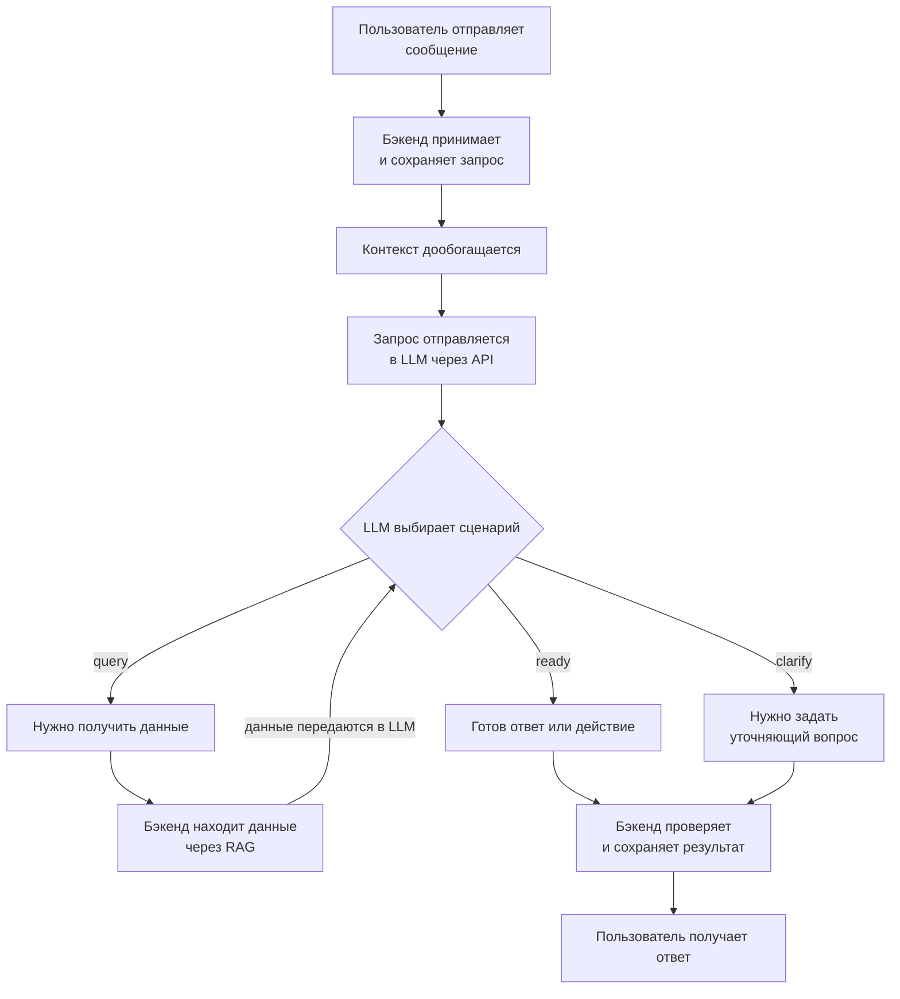

# Архитектура работы с LLM

[← Вернуться в основной README](../../README.md)

## Как обрабатывается запрос

## Как LLM выбирает сценарий

## Подробные схемы сценариев

| Сценарий | Что происходит | Схема |
|---|---|---|
| `ready` | Модель подготовила ответ или действие | [Открыть](ready.md) |
| `clarify` | Для продолжения не хватает данных пользователя | [Открыть](clarify.md) |
| `query` | Модели нужны сохранённые задачи, встречи или напоминания | [Открыть](query.md) |

> LLM не изменяет данные напрямую. Она возвращает структурированное решение, а бэкенд проверяет его и только после этого сохраняет результат.
